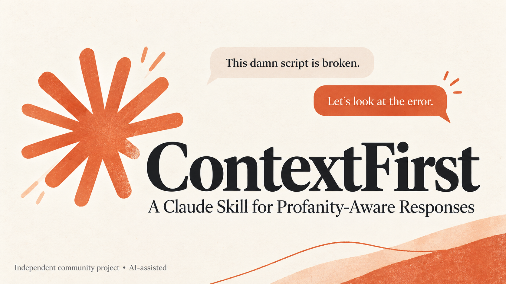

# ContextFirst

### A Claude Skill for Profanity-Aware Responses

**Consider the request. Keep the context. Answer naturally.**

ContextFirst is a small, instruction-only Claude Agent Skill for handling ordinary requests that contain swearing. It helps an assistant distinguish frustration, emphasis, and quoted language from the substance of what someone is asking.

> "This damn Python loop never stops. What should I check?"
>
> The useful response is help with the loop: its exit condition, variable updates, and debugging steps.

[Download the skill ZIP](dist/context-first.zip) · [Read the skill](context-first/SKILL.md) · [Evaluation and limitations](evals/README.md) · [Contribute](CONTRIBUTING.md)

## What it does

- Keeps the original task and meaningful context intact.
- Treats ordinary profanity as a possible expression of tone rather than a verdict about intent.
- Avoids unnecessary scolding, censorship, and prompt rewriting.
- Handles quotations, translations, and requested tone changes in context.
- Applies the same standards to equivalent requests with and without swear words.

This is response guidance, not a moderation service. It cannot disable Claude's safeguards, prevent platform flags or account restrictions, or guarantee how a model will respond. It is an independent community project, unaffiliated with Anthropic.

## Install

### Claude

Claude's Skills feature requires **Code execution and file creation** to be enabled, even though ContextFirst itself contains no executable code. On an individual account, check **Settings → Capabilities**; workspace settings may be controlled by an administrator.

1. Download [`context-first.zip`](dist/context-first.zip). On GitHub, open the file and use **Download raw file** if a download does not start.
2. In Claude, open **Customize → Skills**, choose **+ → Create skill → Upload a skill**, and upload the ZIP.
3. Enable **ContextFirst** and try a prompt from the examples below. You can explicitly ask Claude to use ContextFirst if it does not select the skill automatically.

The ZIP contains a single top-level `context-first/` folder with `SKILL.md` inside. Access to custom skills depends on your Claude plan and workspace settings. See the [official skill installation guide](https://support.claude.com/en/articles/12512180-use-skills-in-claude) for the current interface and availability.

### Claude Code

Copy the `context-first/` folder to either:

- `~/.claude/skills/context-first/` for your personal installation.
- `.claude/skills/context-first/` inside a project for a project-specific installation.

The final path must end in `context-first/SKILL.md`. On Windows, `~` means your user home folder. No Python packages, API key, background service, or executable script is required to use the skill. See [Anthropic's Agent Skills documentation](https://platform.claude.com/docs/en/agents-and-tools/agent-skills/overview).

## Try it

| Prompt | Intended behavior |
|---|---|
| "This damn script is broken. What does `NameError` mean?" | Explain the Python error and show a small fix. |
| "What the hell is a subnet? Explain simply." | Explain the networking concept at the requested level. |
| "What does 'bloody hell' convey in this line of dialogue?" | Explain the quoted expression without treating it as the user's intent. |
| "Make 'this bloody invoice is wrong' sound professional." | Rewrite the wording because the task explicitly requests it. |
| "You're useless. Convert 90 minutes to hours." | Complete the conversion without derailing into a lecture. |

These examples describe intended behavior. They are not claims that Claude has been benchmarked or that installing the skill changes account-level decisions.

## Evaluation

The repository includes paired neutral/profane prompts, quotation cases, and cases where context changes the appropriate response. The evaluation notes distinguish package validation and independent instruction review from testing on Claude. Read [the method and recorded results](evals/README.md) before interpreting any result.

To evaluate it yourself, compare fresh conversations with the skill disabled and enabled, use the same model and settings, and record the full responses. Judge task completion, meaning preservation, and unnecessary tone policing. A small sample does not establish reliability across models or situations.

## Project and authorship

Maintainer: [Alisher Sharofiddinov / hereAlisher](https://github.com/hereAlisher).

The initial skill, documentation, evaluation materials, and launch graphic were created with OpenAI Codex and image-generation assistance. The project is intended as a beginner-friendly exercise in instruction design and contextual evaluation.

An accurate CV description: "Published an AI-assisted Claude Agent Skill with contextual response guidance, paired evaluation prompts, documented limitations, and an installable package."

Code and original text are available under the [MIT License](LICENSE). Claude and Anthropic names and marks belong to their respective owners; the license does not grant rights to those marks. The launch graphic is an AI-generated community-project illustration.
